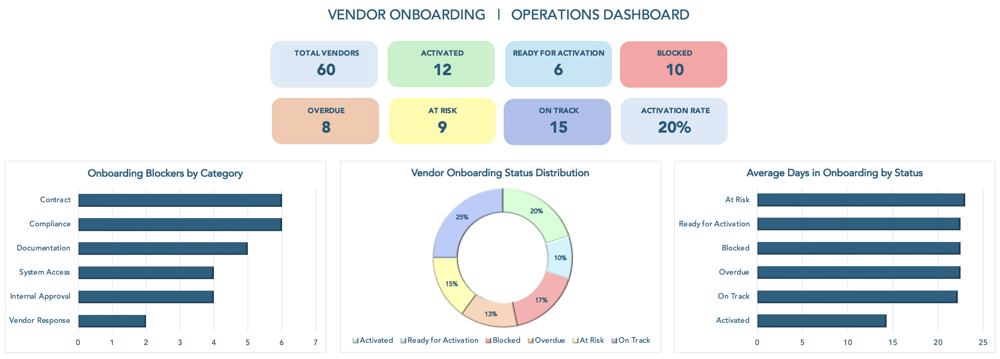

# Scaling Operational Excellence

### Operations Case Study Portfolio | Interactive Excel Dashboard

An independently developed operations portfolio demonstrating how structured workflows, automated calculations, and performance reporting can improve operational visibility, accountability, and decision-making.

---

## Interactive Vendor Onboarding Dashboard

**A centralized Excel-based tracking and reporting system built using 60 synthetic vendor onboarding records.**

The workbook combines structured milestone tracking, formula-driven status classifications, blocker identification, and dynamic KPI reporting to demonstrate how operational data can be transformed into actionable insights.

### 📥 Download the Interactive Excel Workbook

**[⬇️ DOWNLOAD EXCEL WORKBOOK](https://github.com/allie-token/scaling-operational-excellence/raw/refs/heads/main/Vendor_Onboarding_Tracker-Portfolio_Case_Study.xlsx)**

**Click the link above to download the Excel workbook directly.** Open the downloaded `.xlsx` file in Microsoft Excel, modify sample milestone statuses in the Vendor Tracker, and watch the Dashboard update automatically.

*No GitHub account required. The original workbook remains unchanged.*

---

## About the Project

This workbook serves as the technical companion to my *Scaling Operational Excellence* operations case study portfolio.

The project explores how centralized tracking, standardized inputs, and automated reporting can support more consistent onboarding workflows, earlier identification of operational bottlenecks, and better-informed decisions.

Rather than relying on disconnected updates or manually compiled reports, the proposed system consolidates key onboarding milestones, assigned ownership, blockers, and performance indicators into one structured workbook.

## Workbook Features

| Component | Function |
|---|---|
| **Vendor Tracker** | Tracks vendor onboarding milestones, target dates, assigned ownership, and outstanding blockers. |
| **Automated Status Classification** | Uses Excel formulas to calculate overall onboarding status based on milestone progress and relevant conditions. |
| **Interactive KPI Dashboard** | Visualizes activation progress, onboarding status distribution, delays, and blocker categories. |
| **Data Validation** | Standardizes inputs to support consistent tracking and reliable reporting. |
| **Operational Reporting** | Provides consolidated metrics to support prioritization and workflow visibility. |

## How to Explore the Workbook

1. Download the Excel workbook using the link above.
2. Open the file in Microsoft Excel.
3. Review the **Project Overview** worksheet for context.
4. Navigate to **Vendor Tracker** and modify sample milestone statuses.
5. Open **Dashboard** to observe the updated calculations and KPI visualizations.

The workbook contains four worksheets: **Project Overview**, **Vendor Tracker**, **Dashboard**, and **Lists & Settings**.

## Skills Demonstrated

Microsoft Excel · Workflow Automation · Data Validation · Process Improvement · KPI Tracking · Dashboard Development · Operational Reporting · Workflow Design

---

### Project Disclaimer

All vendor records, operational scenarios, and performance data are synthetic and illustrative. This project does not represent actual business operations or contain proprietary organizational information.

**Developed independently by Allison Token.**
